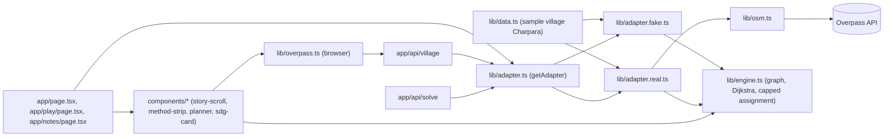

# Puteal

Puteal is a village map for arsenic-affected Bangladesh that sends every household to a safe tubewell along real footpaths, keeps any one pump from getting crowded, and shows where the next deep well would bring the most people back within reach. About half of the tested tubewells in Bangladesh carry more arsenic than the WHO allows, and the cheapest fix, walking to a neighbour's safe pump, stalls because nobody tells a family which pump to use.

**Live:** https://puteal.vercel.app. Start at DEMO step 1: open `/` and scroll the story.

**Real versus sample data:** the buildings and footpaths in live mode are real OpenStreetMap buildings and footpaths; the arsenic values are sample, or "imported test values" after a CSV import.

## Try it in 60 seconds

1. Open https://puteal.vercel.app (`/`) and read the headline.
2. Scroll to chapter 3, "Share the load": the pinned village plan switches to capped pumps and the text names the numbers the engine just computed.
3. Keep scrolling to the last chapter, "Where the next well goes", and tap an open footpath corner on the plan to drop a deep well. The "people over 500 m" count under the plan falls on the spot.
4. Open https://puteal.vercel.app/play?limit=10&cap=1&add=1255,185 for the free planner with the WHO limit, capped pumps and one deep well already placed; click any house for its route card.

## The problem

About half of the tubewells tested in Bangladesh carry more arsenic than the WHO guideline of 10 µg/L (figure from keebsforwater.org). Drilling a deep well for every family is slow and expensive. The cheapest step that works is well switching: a family with a red-painted spout walks to a neighbour's pump that tested safe.

The odd part is that safe water is often close. Studies in Araihazar upazila found that around 90 percent of people live within about 100 m of a safe well, and switching still stays low. Two things get in the way. Nobody tells a household *which* well to use, and the few good pumps get crowded until the queue costs more than the risk feels worth.

**Who it is for:** NGO field staff, union council health workers, and student volunteers running well-testing campaigns in arsenic-affected villages.

**SDG link:** UN SDG 6, target 6.1: universal and equitable access to safe and affordable drinking water. Puteal's output is the indicator itself, counted per village: how many people live more than 500 m from a safe source.

## The solution

Puteal turns a village into a walking graph and answers the question for every door.

1. **Walking graph.** Footpaths are cut into 25 m segments; houses and wells join at the nearest node. In live mode the houses and footpaths come from OpenStreetMap through the Overpass API.
2. **Capacity-aware assignment.** Dijkstra runs from every well that passes the chosen limit. Households are then served in order of regret (whoever loses most by being bumped picks first), and each takes the nearest safe pump that still has room. A pump in the sample is capped at 80 to 200 people.
3. **The limit is a switch.** Flip between Bangladesh's 50 µg/L and the WHO's 10 µg/L and watch wells turn red and the walks redistribute.
4. **The next deep well.** Click any spot to drill a deep well. The count of people beyond 500 m updates immediately, so a union council can compare sites before spending.
5. **Route cards.** Click a household to get a printable card: which well, its test result, distance along the path, minutes each way.
6. **Your own wells, and the plan out.** In the planner, import a CSV of the village's tested wells (`name,lat,lon,arsenic_ugl` plus an optional `capacity`, up to 40 rows; `fixtures/wells-example.csv` shows the shape). Bad rows are listed by line, and the readout then says "imported test values". "Export assignments (CSV)" downloads one row per household. Both happen in the browser; nothing is stored on a server.
7. **Shareable plans.** The planner's address carries the limit, the pump cap and your deep wells, so a link opens the same plan.
8. **An SDG 6.1 statement.** Under the planner's readout, a summary card states the plan in the target's own terms: people farther than 500 m before and after your deep wells, and the mean walk. It prints on its own.

The home page tells this as a five-chapter scroll story on one live village plan, followed by a strip that walks through the four engine steps with numbers from the sample village. `/play` is the same engine with every control open, and `/notes` holds the method and sources.

## How it fits together



## Live mode

By default (or with `ADAPTER_MODE=real`) the village layout comes from live OpenStreetMap: the server asks the public Overpass API for every building and walkable way in a 1.3 km square around the sample village, turns each building into a household of 4.2 people, and runs the same engine on it. The real adapter needs no key. The wells, their sample arsenic values and the six hamlet names stay sample data.

The real adapter answers from the first source that works: the server's own copy if it is younger than 10 minutes, a live OpenStreetMap read (four public Overpass instances and the OpenStreetMap main API `map.json` asked at once, the first usable answer wins, each retried once, 20 seconds in all), the snapshot `fixtures/osm-charpara.json`, then the sample village Charpara, with one calm line under the plan saying so. With `ADAPTER_MODE=fake` everything runs on the sample village.

Last proof of the live path:

<!-- PROOF:BEGIN overpass -->
Not run in this build: no OpenStreetMap source returned a usable layout (at least 30 buildings, 50% of them within 500 m of a sample well), neither an Overpass instance nor the OSM API (upstream_timeout: maps.mail.ru POST: upstream_error, status 504; maps.mail.ru POST: upstream_error, status 504; overpass-api.de POST: upstream_error, network; overpass-api.de POST: upstream_error, network; overpass.private.coffee POST: upstream_timeout; overpass.kumi.systems POST: upstream_timeout; overpass.private.coffee POST: upstream_timeout; overpass.kumi.systems POST: upstream_timeout; layout too sparse: 16 buildings, 0 within 500 m of a sample well (needs 30 buildings, 50% near)). No snapshot was saved; the pages show the sample village and say why.
<!-- PROOF:END overpass -->

<!-- PROOF:BEGIN engine -->
Run on 2026-11-24 on the sample village Charpara (100 households, 420 people, sample wells), solved in 17 ms: one deep well by Char para brings 67 people back within 500 m of safe water (126 to 59 far at 10 µg/L). No usable OpenStreetMap layout was available in this build (no source returned enough mapped buildings near the sample wells, and no usable saved snapshot), so that figure was not computed.
<!-- PROOF:END engine -->

## Quickstart

```bash
npm install
npm run dev        # http://localhost:3000
npm test           # vitest: engine, OSM parser, schemas, planner URL, wells CSV
npm run proof      # rewrites the proof lines in this file and DEMO.md
```

No environment variables are required. `.env.example` lists the optional `ADAPTER_MODE` (default `real`, set `fake` for the sample village only) and `OVERPASS_URL` (one URL or a comma-separated mirror list).

Last proof of the planner round trip (the example wells CSV through the planner's parser and the engine):

<!-- PROOF:BEGIN planner-roundtrip -->
Run on 2026-11-24: fixtures/wells-example.csv gives 12 valid wells and 1 rejected row. On the sample village at 10 µg/L with those wells, 67 people live more than 500 m from their assigned safe well (126 with the sample wells).
<!-- PROOF:END planner-roundtrip -->

## Addresses

| What | Address |
| --- | --- |
| Live site | https://puteal.vercel.app |
| Repository | https://github.com/mericcintosun/puteal |

Puteal has no smart contracts and no chain; see SECURITY.md.

## Placements and sponsor tech

Puteal is entered in the Acodemic X KeebsforWater Global SDG Hackathon. One submission enters all three placements:

| Placement | Prize |
| --- | --- |
| 1st Place | $ 20 in cash |
| 2nd Place | $ 10 in cash |
| 3rd Place | $ 5 in cash |

| Bounty | Prize | Slots | Required tech | Code file | DEMO step |
| --- | --- | --- | --- | --- | --- |

The event publishes no sponsor bounty, so no row above is filled in and no sponsor integration was built. The external services Puteal calls are public and keyless: the Overpass API (`lib/adapter.real.ts`, `lib/osm.ts`) and OpenStreetMap raster tiles through MapLibre GL JS (`components/village-map.tsx`).

## Tech stack

- Next.js 15 (App Router), React 19, TypeScript (strict)
- Tailwind CSS 4 with shadcn-style components (`components/ui/*`), lucide-react icons
- MapLibre GL JS 5 over OpenStreetMap raster tiles
- Motion 14 and Lenis 1 for the scroll story, the parallax first screen, the method strip and the SDG card's count
- zod 3 for request and Overpass response validation
- Hand-written walking graph, binary-heap Dijkstra and regret-ordered assignment in TypeScript (`lib/engine.ts`), on the browser's main thread
- Vitest 3 for tests, tsx for the proof script
- Overpass API, called from the server, no key
- Hosted on Vercel

## What we would build next

- Move the solver into a Web Worker so OSM villages with thousands of buildings stay smooth (live mode keeps the nearest 700 buildings for now).
- Replace the greedy pass with an exact min-cost flow and compare the two on real villages.
- An "edit this well" panel next to the CSV import, and imported wells carried in the share link.
- Suggest the best deep-well site automatically by scoring every graph node.
- Bangla route cards.

## AI use

The hackathon rules say AI tools, coding assistants and AI-generated content are explicitly allowed. We used AI coding assistants for scaffolding, boilerplate and copy drafts; the product decisions, the engine design and the final review are our own.

## License

The repository does not carry a LICENSE file yet, so no open source license is granted at this point.
